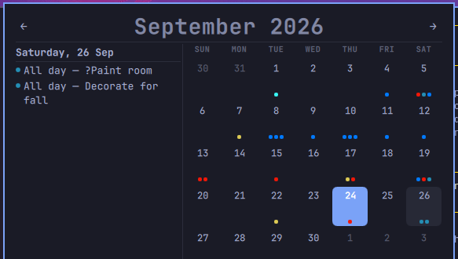
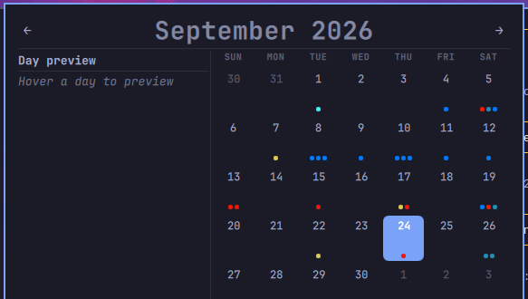
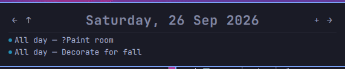

# omacal

CalDAV-backed calendar popup for the Omarchy desktop. A bar widget replacing
the clock label with a proper calendar: month grid, day view, event
add/edit/delete, recurring events, and a first-run setup flow — pulling from
any CalDAV server (Nextcloud, Fastmail, iCloud, your own, …).

## Screenshots

Month view, with the hovered-day preview pane on the left showing that day's
events as you move across the grid:



Month view showing the preview pane's empty state ("Hover a day to preview"):



Day view, showing a day's events with add/edit/delete via click or keyboard:



## Install

Two steps: install the plugin, then install its backend daemon.

```bash
# 1. Clone + enable the plugin (shell only, loads the QML frontend)
omarchy plugin add <repo-url> --enable

# 2. Install the Python backend (CalDAV sync + local API). Run from the
#    plugin folder.
cd ~/.config/omarchy/plugins/omacal
./install.sh
#
#    install.sh also asks whether to replace the stock omarchy.clock widget
#    with omacal in the bar (Y/n). Answer yes to swap them; answer no to keep
#    both and edit ~/.config/omarchy/shell.json yourself.

# 3. Start the daemon (once; it is enabled to run on login)
systemctl --user start omacal
```

That's it. On first use the clock shows a "Setup needed" popup — enter your
CalDAV server address (a bare `https://cloud.example.com` works; discovery
finds the CalDAV path), your username, and password. The password is stored in
the system keyring, never in a file.

**Uninstall:**

```bash
cd ~/.config/omarchy/plugins/omacal
./install.sh --uninstall        # removes backend, venv, and systemd unit
omarchy plugin remove omacal    # removes the plugin itself
```

### What each piece does

| Piece | Installed by | Where |
|-------|-------------|-------|
| QML frontend (bar widget + panel) | `omarchy plugin add` | `~/.config/omarchy/plugins/omacal/` |
| Bar swap (omacal replaces `omarchy.clock`) | `install.sh` (opt-in Y/n) | `~/.config/omarchy/shell.json` |
| Python backend + sync daemon | `install.sh` | venv `~/.local/omacal/venv/`, API on `127.0.0.1:9876` |
| systemd user service | `install.sh` | `~/.config/systemd/user/omacal.service` |
| CalDAV config | first-run setup | `~/.config/omacal/config.json` (URL/username only; password in keyring) |
| Event cache (SQLite) | backend | `~/.local/share/omacal/calendar.db` |

## Features

- **Month grid** with 5 or 6 week rows, colored per-calendar event dots, week
  start toggling (`w`).
- **Day view** of any day's events — click a day, or arrow between days and
  months.
- **Add / edit / delete events** (keyboard + mouse): summary, location,
  calendar, all-day, start/end time, repeat (daily/weekly/2-weekly/monthly/
  yearly with count or end-date), notes.
- **Recurring events** expanded client-side; editing one occurrence (EXDATE)
  or the whole series, without clobbering the master.
- **All-day and multi-day events** handled with correct iCalendar semantics.
- **First-run setup** — no manual config file editing to get started.
- **Incremental sync** (RFC 6578) + on-open refresh; the cache window keeps
  one-offs for -30/+90 days and syncs every 60s.
- **Reminders** (CalDAV `VTODO`) with a dedicated section — see [Reminders](#reminders).
- **Calendar management** — a calendar-select dialog to show/hide calendars, add or
  subscribe to calendars, edit owned calendars' name/color, delete them, and
  pick colors — see [Calendars](#calendars).

## Calendars

The calendar-select dialog lists every known calendar with a toggle row each.

- **Show / hide** — toggled-off calendars stop rendering dots and listing
  events in the month/day views.
- **Add (`+`)** — a mini form creates a new named calendar on your server, or
  **subscribes** to an existing one: paste its collection URL and the submit
  button reads "Subscribe" instead of "Create".
- **Color** — pick from preset swatches ("Select calendar color:"); the color
  is written to the server (CalDAV `calendar-color` property) and round-trips
  through sync.
- **Edit** — the pencil button on a row (or `e` on the row under the cursor)
  opens a mini form to rename and/or recolour the calendar. Both fields are
  optional — leave one alone to keep it. Only calendars you own can be edited;
  shared and subscribed rows never show the button. Changes are written to the
  server (CalDAV `name` + `calendar-color` properties) and round-trip through
  sync.
- **Delete / unsubscribe** — right-click or `d` on a row. Calendars you own are
  deleted from the server; shared or subscribed calendars are only
  unsubscribed — the server's data is left untouched.
- **Keyboard** — arrows / `Tab` / `Shift+Tab` move the cursor between rows
  (the **Done** button highlights when the cursor lands on it), `Enter`
  selects, `d` deletes, `e` edits the row under the cursor.

## Google calendars (provider support)

Calendars can come from the Google Calendar API v3 instead of a CalDAV
server. A config entry names the provider; no URL is needed — the account is
the OAuth token set:

```json
{ "provider": "google", "display_name": "Google" }
```

Sign in first (`omacal oauth login google`), with the `oauth.google` client
section configured: Google's installed-app clients still demand the
`client_secret` in the token exchange (confidential mode — PKCE alone gets
"client_secret is missing"), and the scope must be the broad
`https://www.googleapis.com/auth/calendar` — the granular
`calendar.calendars`/`calendar.events` do NOT cover `calendarList` (403).
`access_type=offline` + `prompt=consent` give a refresh token; note
unverified consent screens expire refresh tokens after ~7 days, then the
re-consent prompt fires automatically. The Calendar API library itself must
be ENABLED in the Cloud project (403 "API has not been used" otherwise).

- **Discovery** — the user's calendar list (`/users/me/calendarList`) becomes
  cache rows with `provider: "google"` provenance (schema v12) and the Google
  calendar id as `uid`; the cache URL is namespaced `google:<id>`.
- **Sync** — one events fetch per calendar with Google's own syncToken
  (incremental; a dead token falls back to a full fetch), quota/429 backoff
  handled in the adapter. The fetch window is ±12 months, not the CalDAV
  [-30, +90] days: Google exposes recurring series as **instances**
  (`recurringEventId`), never the master RRULE, so instances cache as
  one-off rows and the window is their visibility.
- **Write side** — create/edit/delete route by provider: Google rows report
  `writable: true` and go through the Calendar API (insert/patch/delete/move)
  instead of CalDAV PUT. Google's instance ids are first-class, so editing or
  deleting one occurrence of a series is a PATCH/DELETE on the instance row —
  no EXDATE/RECURRENCE-ID surgery. The panel sends `occurrence=<stamp>` on a
  single-instance edit; without it, an edit PATCHes the master
  (`recurringEventId`) and renames the whole series, and `series=true` on a
  delete does the same. Instance rows carry `recurrence_id` from Google's
  `originalStartTime` so the panel renders them as series occurrences.
  Deleting a whole series deletes the master (and prunes its instance rows).
  Recurring creates need the IANA zone inside
  `start.timeZone`/`end.timeZone` (Google ignores a top-level `timeZone` there
  and rejects the insert with "Missing time zone definition for start time").
  Cross-provider moves (Google ↔ CalDAV) are refused; reminders on Google
  calendars need the Tasks API and raise a clear error until wired. The panel mirrors
  this: reminder routing skips Google calendars, the edit-form Calendar dropdown
  offers same-provider calendars only, and the REMINDER type toggle is blocked
  while editing a Google event. Add Calendar offers a 'Create on Google' checkbox:
  the POST carries provider=google and add_calendar_named honors an explicit provider
  over the presence heuristic (provider=caldav requires a configured CalDAV account).
  Calendar rename PATCHes the calendar resource (`summary`); recolour PATCHes the
  calendarList ITEM (`/users/me/calendarList/<id>`) with `backgroundColor` +
  `foregroundColor` and `colorRgbFormat=true` as a QUERY PARAM — colour is a
  per-list-user subscription property, and without the flag the colour fields
  in the body are silently ignored (`colorRgbHex` on the calendar resource is
  not writable at all; Google auto-matches the nearest `colorId`). The read
  side prefers `backgroundColor` (`colorRgbHex` is usually absent). Panel
  colours are #RRGGBB[AA]; the alpha pair is dropped.

## Reminders

Reminders are CalDAV `VTODO` items — the same add/edit/delete flow as events,
toggled via the **Event / Reminder** buttons in the form.

- **Creating** — pick **Reminder** in the add form. A new reminder defaults to
  **All Day** and is routed to the task calendar (a `VTODO`-capable one); the
  calendar dropdown is hidden because there's only that target. Editing an
  existing reminder keeps its own all-day state and calendar.
- **Alarm (heads-up)** — shown only in reminder mode. Timed reminders fire an
  offset before their due time: *5 min / 15 min / 30 min / 1 hour / 2 hours /
  1 day before* (default **1 hour** before DUE). All-day reminders fire at a
  fixed time on the due date (hour + minute, default **09:00**).
- **Display** — reminders render as an **outlined (hollow) dot** so they read
  distinctly from filled event dots, in the month grid, day view, and preview
  pane.
- **Sync & completion** — reminders sync through the same CalDAV change stream
  as events and are dropped when their `VTODO` is `COMPLETED`/`CANCELLED`. A
  recurring reminder toasts each occurrence once (the fired table dedupes).

## Keyboard

| Key | Month view | Day view | Add/edit form |
|-----|-----------|----------|----------------|
| `←` / `→` | prev/next month | prev/next day | form field |
| `↑` / `↓` | prev/next year | — | form field |
| `[` / `]` | prev/next month | prev/next month | — |
| `t` | go to today | go to today | — |
| `w` | toggle week start | toggle week start | — |
| `+` | — | new event | — |
| `Enter` | close | close *(new event: submit)* | save |
| `Esc` | close | close | dismiss form |
| `Backspace` | — | back to month | dismiss form |

## Development

```bash
git clone <repo-url> omacal && cd omacal

# Backend
python3 -m venv backend/.venv
backend/.venv/bin/pip install -e backend/
backend/.venv/bin/omacal-api --debug        # serves 127.0.0.1:9876

# Frontend — this repo IS the plugin folder, so point the shell at a clone:
#   cp -r . ~/.config/omarchy/plugins/omacal    (or `omarchy plugin add`)
# The plugin hot-reloads on file save; a full `pkill -SIGUSR1 quickshell`
# reloads BarWidget.qml if a change doesn't take.

curl -s http://127.0.0.1:9876/api/health    # {"status":"ok",...}
```

Validate a clone as a plugin folder:

```bash
omarchy plugin validate .
```

## Layout

```
omacal/
├── manifest.json         # plugin manifest (root — this repo is a plugin folder)
├── frontend/             # QML bar widget + calendar panel
│   ├── BarWidget.qml     #   bar label + panel host
│   ├── omacal-panel.qml  #   month/day calendar (installed as Panel.qml)
│   ├── SetupForm.qml     #   first-run CalDAV setup
│   ├── AddEventForm.qml  #   add/edit event form
│   ├── Model.js          #   date math + clock format ring (shared)
│   └── …                 #   DateEntry, FormLabel, KeypadTextField, …
├── backend/              # Python package: sync daemon + local API
├── systemd/              # omacal.service (backend unit)
└── install.sh            # backend installer (run from the plugin folder)
```

## License

MIT — see [LICENSE](LICENSE).
